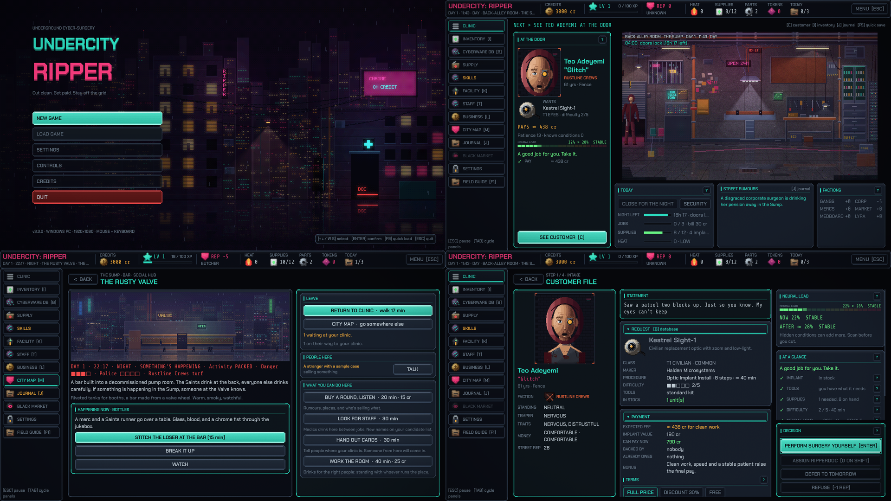
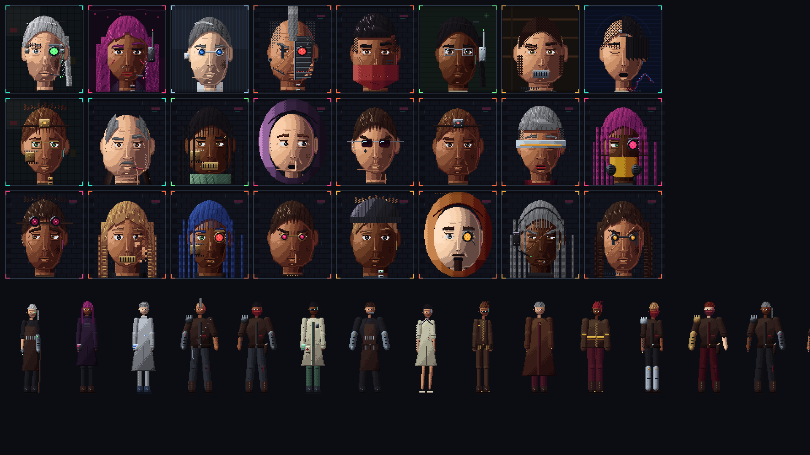
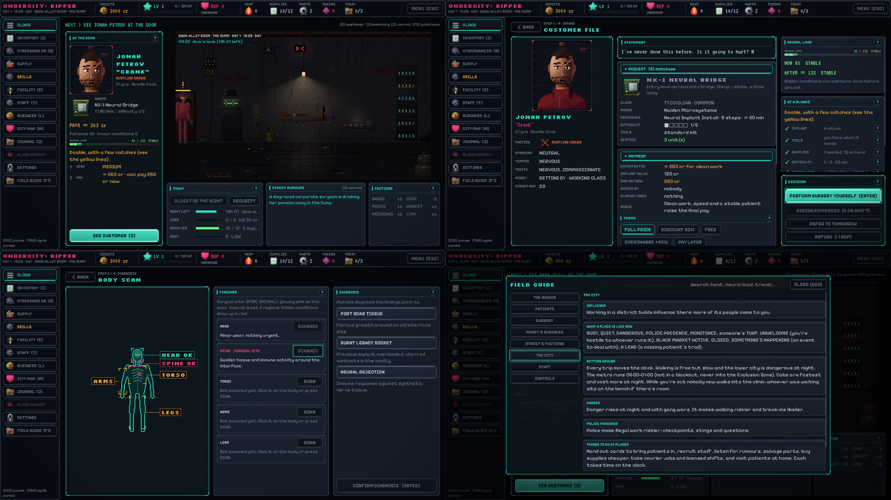
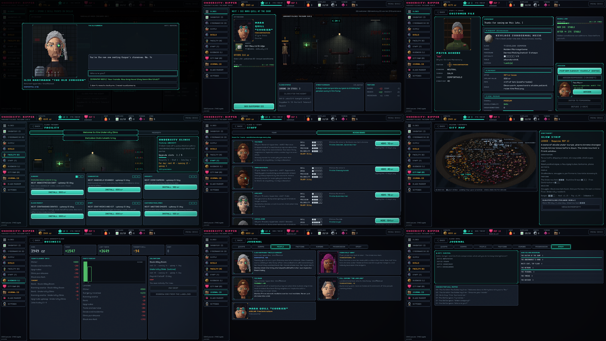

# UNDERCITY: RIPPER

An original 2D pixel-art cyberpunk surgery sim for **Windows PC**, designed
for **1920×1080** and played with **mouse and keyboard**. You are an illegal
ripperdoc in Caldera, a flooded megacity: start in a back-alley room with
almost nothing, take customers, install cyberware at a surgical workstation,
hire staff, buy clinics across the city, and decide what you become while a
corporate conspiracy spreads through your patients' nerves.

**Status: 3.12.0**: the world reacts. Taking a side costs you
standing with its rivals, your choices bring factions, friends and old
grudges back to the door, and the clinic screen is simpler: one clock, a
clearer NEXT and risk in plain words.

**3.11.0**: the mystery reaches the operating table. Seven story
patients bring clues and decisions that come back later, short skippable
scenes mark each chapter, the clinic day has a calmer rhythm, and the
city turns through four seasons of weather.

**3.10.0**: a scan that finds a condition says what it changes
and what to do about it. Far fewer jobs lose money, and storage can sell
unwanted implants, tools and supplies.

**3.9.1**: the patient's full file and the scan show essentials
first, with the rest folded. In surgery, each mistake says once what it
cost and what to do differently.

**3.9.0**: less on screen. A patient opens on what they want, one
risk sentence, the money and ACCEPT JOB, with DETAILS one click away. The
clinic keeps one objective and one status line. The tutorial is one short
step at a time on the real controls, and sections appear only when they
matter, each introduced on its own button. One TUTORIAL & GUIDANCE setting
(GUIDED / BRIEF / OFF).

**3.8.0**: every patient arrives with a **PATIENT INTAKE FORM**, an
in-world document of their request, risk factors and history, each line
marked REPORTED, ON FILE, CONFIRMED, SUSPECTED or UNKNOWN. Hidden conditions
stay hidden until you scan.

**3.7.0**: easy to learn, still deep. Click a patient for a
one-screen **PATIENT SUMMARY**: what they want, how hard it is, your
estimated odds, what you'd keep, and ACCEPT JOB / DECLINE / MORE DETAILS.
**CLINIC STATUS** says in one line what needs you. The side bar starts small
and grows: sections appear when they become useful, each with a short card.
Purchases show **BEFORE YOU PAY** (cash now → after). The field guide holds
back what you haven't met yet and lets you see every tutorial card again.

**3.6.0**: a quality pass. You can **CLOSE THE DOORS** to stop
walk-ins while you read, shop or level up. Clicks, purchases and scaling
hold steady at every window size. Every job shows **PAYMENT / USES UP /
YOU KEEP** before you cut and **THE MONEY** after. BUSINESS has an
**OUTLOOK**. The journal's **STANDING** tab says what each reputation,
relationship, trust and heat value does, where it's heading and what
changed it. A **GUIDANCE** setting (minimal / standard / detailed) sets
how much the screens explain.

**3.5.0**: the game now tells you what matters. WHAT MATTERS NOW
on the clinic screen ranks what needs you (■ critical, ▲ important) and
takes you there in one click; CLINIC STATUS sums up money, standing, staff,
supplies, heat and the black market with ✓ / ! / ✕; a SURGERY PREVIEW shows
risk, time, cost, pay, likely complications, your odds and who should
operate before you cut; staff are ranked with a ★ RECOMMENDED; big decisions
show what they changed; RECENT CHANGES (G) lists what moved while you were
busy; ☆ FOLLOW keeps quests, people and places on the journal's new MAIN
page; and first-time hints explain each system once. Every key is
rebindable (primary and secondary, modifiers, mouse buttons, search,
presets, conflict REPLACE / SWAP / CANCEL, reset one, a category or all).
3.4 brought a new art style with twice the detail: clinic rooms,
characters and city streets redrawn at 1.5x the resolution (shown at 2
screen pixels per art pixel), a neon-alley title screen, and straight,
readable cyberpunk type everywhere (Chakra Petch and Share Tech Mono).
3.3 brought a clearer, better-looking UI: a searchable FIELD GUIDE
(F1), every stat explained on hover and click, an AT A GLANCE verdict for
each patient, a redesigned body scan, new character eyes and hair, bodies
that match their portraits, and adjustable room brightness. 3.2 "The living city" added twelve places across Caldera's seven
districts (bars, a night market, the Undermarket's tunnels, the works, the
Plaza, tenements, the interchange, the Exclusion Zone), travel that costs
time and money, patients and the cast with routines you can follow, events
at every kind of place, faction presence you can see and shift, and a
missing-patient trail; on top of 3.1 "The world reacts": patients who remember you and come
back changed, staff with lives, a clock from 09:00 to 04:00, a waiting room
and a Clinic Wall, a city with its own situations and news, surgical
dilemmas, emergency triage, a black-market supplier network, break-ins and
investigations, on top of 3.0 "The Underground" (characters, clinics,
staff, business, districts and a five-act story). The game has:
- a living city: twelve places with hours, states, people, 22 services and 40 events; walk / metro / cab; encounters on the way; NPC routines; discovery; the Exclusion Zone
- a living world: people, memories, payment terms and debts, staff lives and bonds, day and night, waiting room, the Wall, city situations and news, surgical dilemmas, triage, six black-market contacts, heat levels, thefts and investigations
- a dark, grimy look: seven lit clinic interiors with grime, waste and failing light; very little neon
- detailed characters: layered portraits and bodies built from parts, occupation and faction looks, a ten-person story cast whose looks change with the story, idle animation everywhere
- seven purchasable clinics in seven districts, six upgrade categories that visibly change the room, business days with rent, salaries, a ledger and debt
- staff to hire, assign, grow and lose: specializations, ethics, traits, loyalty, stress and secrets
- a five-act story: 23 branching conversations with persuasion / intimidation / bribery / empathy / lies / negotiation, delayed consequences, 21 quests, a comms inbox and seven endings
- a desktop "medical workstation" UI: status bar, section nav, multi-panel screens
- a guided first shift, then a gradual learning curve
- 8 operations across 8 cyberware categories, with 27 implants (tiers 1–5)
- a surgery workstation with a zoomable operating field, an instrument rack with hotkeys and tool condition, and emergency actions on keys
- procedural customers with hidden conditions, previous operations, and a neural-load system
- a grid inventory with drag & drop, and a cyberware database with CURRENT vs NEW comparison
- 21 upgradeable tools, 5 factions with heat, a black market with unknown properties
- a 4-branch skill tree, 6 factions, 20 story and random events
- 3 save slots, full keyboard + mouse rebinding, graphics / audio (6 buses) / gameplay / accessibility options
- a layered soundscape and detailed, animated pixel art at one crisp density

[CHANGELOG.md](CHANGELOG.md) lists the changes. Design and code are documented in [docs/ARCHITECTURE.md](docs/ARCHITECTURE.md) and [docs/ART_BIBLE.md](docs/ART_BIBLE.md).










---

## Download and play (Windows)

Get **`UndercityRipper.exe`** from the
[latest release](https://github.com/arvidragno-tech/clod-mobile-game/releases/latest)
and double-click it. It is the whole game in a single file (every expansion
included), with no installer and no admin rights. Saves and settings live in
`%APPDATA%\UndercityRipper\`. The build isn't code-signed, so Windows
SmartScreen may ask once: **More info → Run anyway**.

Releases are built by GitHub Actions (`.github/workflows/release-windows.yml`):
pushing a tag `vX.Y.Z` that matches `config/version` exports the .exe on
Windows, smoke-tests it (new game, every main screen, save and reload) and
publishes it. **Actions → Windows release → Run workflow** builds and tests;
tick **publish** there to also tag `v<version>` and publish the release.

## Requirements

| | |
|---|---|
| Engine | **Godot 4.3 stable**, standard build (GDScript only, not .NET). Newer 4.x versions should open the project and offer to upgrade it. |
| Renderer | GL Compatibility (OpenGL 3.3; runs on any Windows GPU from the last decade) |
| Target | **Windows 10/11, x86_64**, 1920×1080 primary, mouse + keyboard |
| Supported windows | 1920×1080, 1600×900, 1366×768, 1280×720 windowed; borderless fullscreen; exclusive fullscreen |
| Windows export | Godot 4.3 Windows export templates (from any OS: Windows, Linux or macOS) |

## Running the game

### From source
1. Install Godot 4.3 from <https://godotengine.org/download/archive/4.3-stable/>.
2. Open Godot, choose **Import**, and select `project.godot` in this folder.
3. Press **F5** (Run Project).

From the command line: `godot --path .`

The window opens at 1600×900 (windowed) the first time; change the window
mode and resolution in **SETTINGS → GRAPHICS**.

### Controls

| Action | Mouse | Keyboard (default, rebindable) |
|---|---|---|
| Select / use the active tool | left click | ENTER / E |
| Cut, move implants, connect wires | left drag | |
| Put the tool down / cancel / compare | right click | |
| Scroll lists, zoom the operating field | wheel | + / − |
| Inspect | double click | F |
| Field guide (every term explained) | FIELD GUIDE in the sidebar, or click any stat | F1 |
| Pause / back | | ESC |
| Cycle panels | | TAB |
| Recent changes (what moved while you were busy) | CHANGES on the clinic screen | G |
| Back to the clinic | CLINIC in the side nav | H |
| Navigate menus | | WASD / arrows |
| Contextual (hold to infuse, LOCK, SEAT) | | SPACE |
| Previous / next tool | | Q / R |
| Pick tool 1–9 | click the rack | 1–9 |
| Emergency COAG / SEDATE / STABIL | click | Z / X / V |
| Rotate implant | wheel when seated | , / . |
| Inventory · customer · journal · database · supply | side nav | I · C · J · B · U |
| Facility · business · staff · city map · comms | side nav | K · L · T · M · N |
| Dialogue: continue / answers 1–4 | click | ENTER (or SPACE) / 1–4 |
| Quick save / quick load | | F5 / F9 |

Every key can be changed in **Settings > Controls**: two keys per action
(primary and secondary), modifiers (CTRL+S), mouse buttons, a search box,
the presets DEFAULT / WASD / LEFT-HANDED, and a conflict dialog that lets
you REPLACE the other action's key, SWAP them or CANCEL. ESC cancels a
rebind and DEL unassigns a slot; pause, dialogue continue and the contextual
action always keep a key. A first launch offers DEFAULT or CUSTOMIZE.
Hotkeys are context-aware: typing in a search field, reading the field guide,
a dialog or a conversation never triggers navigation underneath, and every
on-screen key hint shows your current key.

Everything gives feedback: hover highlights and a hover tick on every
control, a pointing-hand cursor on clickables, a crosshair over the operating
field, a cyan focus frame for keyboard users, and tooltips.

### Playing a shift

A new game starts a **10-step tutorial** on an easy first patient. Coach marks
point at the control to use, and you can skip it at any time. **ESC** opens
the pause menu (resume, save, load, settings, how to play, main menu, quit to
desktop). The **NEXT** line above the clinic always shows the most useful next
step (click it to go there), **WHAT MATTERS NOW** lists the rest by urgency,
and **CLINIC STATUS** says how the clinic is doing and what to do about the
worst of it. The **JOURNAL** (J) opens on **MAIN**: what you follow (with
where and when), messages waiting for an answer and your objectives; then
MESSAGES, PEOPLE, PATIENTS (with filters), STANDING (reputation, factions, people, trust, heat, each with its trend, effects, next threshold and history), BUSINESS and
DISCOVERIES (story, news, places, the wall). Reading screens, the field
guide and dialogs stop an emergency's countdown. The clinic room is interactive: the diagnostics terminal, operating
table, storage bench, supply cabinet and records server open their screens;
wheel or double-click zooms into the room.

0. **The doors.** **CLOSE DOORS** (TODAY card) stops walk-ins so you can read, shop, restock or spend skill points without someone waiting; **OPEN DOORS** lets the next one in. They open again every morning.
0. **The day.** Each clinic takes a number of jobs per day. When they're done (or whenever you like), **CLOSE FOR THE NIGHT**: rent, running costs, upkeep and salaries are paid, unpaid bills become debt, and the night report shows the ledger. People from the story come to the clinic to talk between jobs; those conversations open by themselves.
1. **Clinic.** A patient shows up at the door, drawn with their own face, outfit and installed chrome. Click them, **SEE PATIENT** or press **C** for the **patient summary** (request, odds, money, decision); **MORE DETAILS** opens the full file. New sections join the side bar as they become useful (after the first job: SKILLS, SUPPLY, INVENTORY, BUSINESS, JOURNAL; three jobs in: STAFF, FACILITY; then the city). The left nav opens **INVENTORY**, **CYBERWARE DB**, **SUPPLY**, **SKILLS**, **FACILITY**, **JOURNAL** and, once you have the contacts, the **BLACK MARKET**.
2. **Customer file.** A three-column dossier: identity and faction on the left; expandable **REQUEST**, **PAYMENT**, **RISK**, **MEDICAL HISTORY** and **PREVIOUS OPERATIONS** in the centre; neural load now vs after and the decision on the right. **PERFORM SURGERY YOURSELF** (ENTER), **ASSIGN RIPPERDOC** (one of your staff does it off-screen, with their odds and their ethics), **DEFER TO TOMORROW** (they may not come back) or **REFUSE** (a little rep and faction standing).
3. **Diagnosis.** Scan body regions (at least 2). Scans can reveal **hidden conditions** (rejection-prone, clotting disorder, neural scarring...), which change how the operation behaves. Then pick a diagnosis.
4. **Plan.** Choose which implant unit to install: stock, buy now, a black-market unit, or a salvaged one. Review the checks:
   - required tools (e.g. a drill for limbs)
   - supplies
   - before → after neural load
   - the customer's consent

   Then **BEGIN OPERATION**.
5. **Surgery.** 8–9 stages depending on the procedure, at the surgery workstation: patient, vitals, ECG and the procedure checklist on the left; the operating field in the centre; instruments (with hotkeys and condition), emergency actions and the implant on the right.
6. **Results.** You get a grade (S–F), pay, XP, rep, a faction change and heat, plus consequences:
   - referral, a return visit, or becoming a regular
   - a post-op complication
   - a neural break

   Then events may trigger. The game autosaves to the active slot.

---

## Difficulty and learning curve

Everything keys off the number of completed jobs (`scripts/core/difficulty.gd`):

| Phase | Jobs | What changes |
|---|---|---|
| Tutorial | 0 | Scripted easy patient, ×1.5 tolerances, no complications, guided steps |
| Learning | 1–2 | Forgiving tolerances, at most one slow complication, calm and stable customers (neural load ≤ 45%), no hidden conditions, no random events, jobs match your tools |
| Street | 3–7 | Assist fades to ×1.0. Hidden conditions, second complications and events begin. The black market arrives around job 6 (rep 18) |
| Undercity | 8+ | Full game: risk scales with chrome tier, neural load and conditions. Tier-4 chrome comes at LV8, the late clinics need high rep |

On top of that, **SETTINGS → GAMEPLAY → DIFFICULTY** picks STORY (wider tolerances, more time, rent ×0.75), STANDARD or BRUTAL (tighter tolerances, shorter timers, rent ×1.3).

Pacing was checked with `tests/balance_sim.tscn`, which runs the real economy for 40 jobs across several player profiles:
- tier-2 chrome arrives about 8–10 minutes in
- the black market opens at about 15–25 minutes
- tier-3 chrome arrives at about 20–45 minutes
- the third clinic comes after about 1 hour (rent and running costs included)

The simulator found no dead ends: there are never more than 3 impossible jobs in a row, money never goes negative, and a struggling player still upgrades the clinic. The checks also close a black-market buy/sell loop.

## Settings and accessibility

Settings are stored in `%APPDATA%\UndercityRipper\settings.cfg`, separately from the saves, so a new game keeps them:
- **Graphics:** window mode (windowed / borderless / fullscreen), windowed resolution (1920×1080, 1600×900, 1366×768, 1280×720), VSync, frame-rate limit (30 / 60 / 120 / 144 / unlimited), pixel scaling (fit, or integer = pixel perfect), texture filtering, CRT filter, scanlines, screen-shake intensity, lighting quality, particle quality, glow, environment effects (dust, steam, sparks, drips, rain)
- **Audio:** master, music, sound effects, ambient, dialogue and interface; each slider drives its own audio bus
- **Controls:** ten categories (movement, interaction, surgery, tools, inventory, map, journal, dialogue, camera, general), two slots per action, keyboard keys or mouse buttons (middle, side buttons, right, wheel); clashes are detected per context (surgery keys can reuse dialogue keys) and offered as SWAP / KEEP BOTH; reset one action or all; mouse sensitivity
- **Gameplay:** text speed, auto-advance dialogue, pause during dialogue, difficulty (story / standard / brutal), autosave (off / every job / every night; quick save, the pause menu and quitting always save), pause on focus loss, confirm dangerous actions, guidance (minimal / standard / detailed: how much the screens explain, never the rules), introduce features gradually (on by default; off shows every section from the start), tutorial hints, tooltips, damage feedback
- **Accessibility:**
  - text scale and large text (the window is the only scale: the 1920×1080 canvas fits it; integer scaling falls back to fit below 1920×1080)
  - high contrast: brighter secondary text and a lighter CRT overlay
  - colour-blind indicators: `[+]` `[~]` `[!]` markers on colour-coded odds and ledgers
  - reduced shake, reduced flashing (no strobing, glitch bursts or cyberware flicker), reduced effects, reduce motion
  - colour-independent status everywhere: `!` on warning vitals, `+`/`x` on plan checks, ▲ ▼ ? ✕ on comparisons, neural bands named in text
- Haptics remain in the code for touch devices but are hidden on PC.

## Project structure

```
project.godot            Engine config (1920x1080 canvas, stretch, autoloads, input, renderer, Windows icon, user dir)
export_presets.cfg       Windows Desktop export preset (x86_64, embedded .pck, icon, version info)
data/                    Game content as JSON (cyberware, tools, surgeries, complications, characters,
                         archetypes, names, dialogue, conditions, factions, skills, clinics + upgrades + overlays,
                         districts, staff, cast, appearance rules, dialogues, quests, story, comms,
                         events, rumors, black market, palettes, character parts)
systems/                 Autoload singletons (the game's services)
scripts/
  core/                  GameConfig (all tuning values), Palette
  data/                  Typed Resource classes + JSON loader
  surgery/               Vitals, scoring, result, site renderer, lighting, stage registry
    stages/              One script per surgery interaction (9 stage types)
  customers/             Procedural customer generator
  art/                   PixelArt (density helpers), CharacterArt (runtime palette compositing)
  ui/                    UIKit: code-built UI helpers
  screens/               One script per screen (+ BaseScreen, Main root)
  components/            Reusable UI widgets (status bar, side nav, item slot, tool rack, vital bar, scan view, FX...)
scenes/                  Screen scenes: main, main_menu, load_game, credits, clinic, customer, diagnosis,
                         surgery, results, shop, inventory, database, black_market, skills, upgrades,
                         dossier, settings
ui/
  theme/main_theme.tres  Global theme (generated by tools/build_theme.gd)
  components/            Reusable UI scenes (dialog)
assets/                  Fonts (OFL), sprites (generated), cursors, Windows .ico, CRT + black-market glitch shaders
audio/                   Placeholder SFX + ambient loop
tools/                   Reproducible generators: art/ (pixel-art pipeline), audio, theme
tests/                   Unit tests, end-to-end bot, stability suite, display probe, compile check, perf probe
docs/                    ARCHITECTURE.md, ART_BIBLE.md, screenshots (ignored by Godot)
LICENSES/                Font licences (SIL OFL 1.1)
```

## Architecture

### Systems (autoloads, `systems/`)

| Autoload | Responsibility |
|---|---|
| `EventBus` | Cross-cutting signals |
| `GameManager` | Game flow: customer → diagnosis → plan → surgery → results, rewards and consequences |
| `CustomerManager` | Story characters, archetypes, procedural generator, arrival queue, history |
| `SurgeryManager` | Runs an operation: stages, vitals, mistakes, complications, quick actions, result |
| `CyberwareManager` | Implant catalogue, tier access, validity |
| `InventoryManager` | Tools, implant instances (condition, hidden traits), supplies, parts, tokens |
| `EconomyManager` | Money: the only place it changes |
| `ReputationManager` | Street rep and tiers |
| `ProgressionManager` | XP, levels, skill points, records |
| `FactionManager` | 5 faction standings and heat |
| `SkillManager` | Skill tree: Surgery / Cybernetics / Medicine / Underworld |
| `ClinicManager` | Seven clinics (owned / active), upgrades and overlays |
| `WorldManager` | Districts of Caldera, influence, walk-in and event weights |
| `LocationManager` | Places in the city: discovery, hours, access, where you are, travel (walk / metro / cab) |
| `WorldSimulationManager` | What each place is like now, who is there (routines, haunts), ambient events, encounters, the missing-patient chain |
| `BusinessManager` | Business days, ledger, nightly costs, debt |
| `StaffManager` / `EmployeeAI` | Hiring board, staff, assignment odds and refusals, nightly growth |
| `CharacterManager` / `CharacterAppearanceManager` / `CharacterPortraitManager` / `CharacterAnimationManager` | Story cast, appearance rules and events, portraits, idle animation |
| `StoryManager` / `DialogueManager` / `QuestManager` / `CommsManager` | Acts, beats, consequences, endings; conversations; quests; inbox |
| `StoryManager` | Story flags, contacts, rumours |
| `EventManager` | Random and story events with choices, timed modifiers |
| `BlackMarketManager` | Stock, unknown traits, buy / sell / study / modify / scrap, cases |
| `ModifierManager` | One stat-modifier stack fed by skills, clinic, tools and events |
| `SaveManager` | Versioned JSON save (v3, with a checksum; migrates v1 and v2) |
| `AudioManager` | Music, ambience profiles and SFX on three buses |
| `UIManager` | Navigation, hotkeys, ESC/pause routing, TAB panel cycling, keyboard focus, hover feedback, toasts, dialogs, shake, flash, `celebrate()` |
| `Settings` | Player preferences (own file): display, audio, controls, gameplay |
| `Controls` | Input actions with defaults, rebinding (conflict swap), key names for hints |
| `TutorialManager` | First-shift coach marks |

How the pieces talk to each other:
- Screens call **GameManager** for flow and **UIManager** for presentation. Screens never create other screens.
- Systems emit signals (on `EventBus`, or on `SurgeryManager` for high-frequency surgery events), and the UI listens to them.
- Pure logic (`SurgeryVitals`, `SurgeryScoring`, `NeuralLoad`, `CustomerGenerator`) has no nodes, so it can be unit-tested.
- Every tunable number lives in `scripts/core/game_config.gd` or `data/*.json`. Every bonus (skills, clinic, tools, events) flows through `ModifierManager` keys, listed in [docs/ARCHITECTURE.md](docs/ARCHITECTURE.md).

### Data-driven content

JSON in `data/` loads into typed `Resource` classes. Godot treats `.json` as a
resource, and the Windows preset also has an explicit `data/*.json` include
filter, so exports pick the files up.

Most new content is a data entry (the full table is in [docs/ARCHITECTURE.md](docs/ARCHITECTURE.md#adding-content)):
- **New implant:** an entry in `data/cyberware.json`. The icon is chosen by category and tier.
- **New surgery:** an entry in `data/surgeries.json`. It lists stages by `type` with their own params, so no code is needed.
- **New event, condition, archetype, faction, skill, clinic, upgrade, district, quest, conversation or story beat:** the matching JSON file (`data/`). Conversations are node graphs in `data/dialogues.json`; beats in `data/story.json` fire them.
- **New interaction type:** subclass `SurgeryStage` and register it in `surgery_stage_registry.gd`.

## How the surgery system works

`SurgeryManager.start_session()` takes:
- a surgery and a customer
- whether the diagnosis was correct
- the implant unit (condition and hidden traits)
- session modifiers (e.g. operating without supplies)

Tolerances scale with:
- the implant's install difficulty
- the customer's neural load and hidden conditions
- tool quality
- skills and clinic modifiers

Each frame it:

- **Ticks the vitals** (`SurgeryVitals`, all values 0–100):
  - **Blood loss** rises at `bleed_rate` while the wound is open. Clotting pulls the rate back toward a baseline.
  - **Health** drains once blood loss passes a safe threshold.
  - **Pain** settles toward a baseline set by the sedation dose.
  - **Neural stability** drains while pain is high and recovers slowly when the patient is calm.
  - **Operation time** counts up and feeds the grade.
- **Checks failure:** health 0 means *flatline*, neural 0 means *neural collapse*.
- **Raises warnings** when a vital crosses its threshold (toast, sound, blinking bar).

Each **stage** is a self-contained interaction drawn over a persistent
`SurgicalSiteView`: the operating room backdrop plus a 160×160 art-pixel
anatomy close-up (neck, forearm, chest, thigh or orbital, recoloured to the
patient's skin). It keeps the incision, clamps, burns, anchors, implant,
wires and stitches across stages. The view renders inside a `SubViewport` at
native art resolution with dithered lamp, monitor and emergency lighting, so
it matches the density of the rest of the game.
Stages never touch systems directly. They emit `mistake`, `effect_requested`,
`feedback` and `stage_finished(quality, data)`, and `SurgeryScreen` routes those
to `SurgeryManager`, the FX layer and audio.

| # | Stage | Mouse / keyboard | Mistakes and consequences |
|---|---|---|---|
| 1 | Prepare patient | **Hold** INFUSE, release in the green band | Underdose: higher pain floor. Overdose: health and neural damage |
| 2 | Incision | Pick the **scalpel** (click or its number key), **drag** along the guide | Drifting off the line: bleeding, pain |
| 3 | Expose interface | Pick the **retractor**, **click** the 4 clamp points | Jabbing tissue: tear, bleeding |
| 4 | Remove damaged tissue | Pick the **cautery**, **hold** the mouse button on dark tissue | Touching nerves: neural damage (cautery also seals vessels) |
| 4b | Drill anchors (limbs, spine) | Pick the **drill**, **hold** on each anchor, release in the green depth band | Too shallow: loose anchor. Too deep: bone crack |
| 5 | Install implant | Pick the **forceps**, **drag** the implant into the socket, **rotate** (drag around it, mouse wheel, or `,`/`.`), SEAT (SPACE); right-click returns a held implant | Misaligned seat: neural damage, lower implant performance |
| 6 | Connect neural interface | Pick the **splicer**, **drag** wires pin → matching terminal (colour *and* shape) | Bad splice: neural shock, pain |
| 7 | Calibrate | **Drag** the slider (or wheel / A-D) to match the waves, LOCK ×3 (SPACE) | Poor sync: neural damage, lower implant performance |
| 8 | Close incision | Pick the **suture**, **click** stitch points in numbered order | Wrong order: bleeding, pain |

Using the wrong tool is also a (rate-limited) mistake. Mistakes stack. Enough
of them, especially on a sensitive patient, will crash the operation (the test
suite proves this).

**Complications.** After the tutorial job, every operation gets at least one,
timed randomly within a stage that allows them. During the learning phase
there is at most one, with a longer timer. There is a chance of a second, which rises with
customer risk and with a wrong diagnosis. Each one has a countdown and a
counter-action:

| Complication | Counter |
|---|---|
| Arterial bleed | COAG |
| Neural spike | STABIL |
| Patient waking | SEDATE |
| Neural feedback (neural load 55+) | STABIL |
| Rejection spasm (hidden *rejection-prone* condition) | SEDATE |

The three quick actions can also be used at any time, but each has a cooldown.

**Scoring.** Average stage quality, final health, final neural stability and
implant performance are combined, plus a time bonus or penalty. That score
gives the grade (S/A/B/C/D, F on failure), pay, XP and reputation
(`SurgeryScoring`, tuned in `GameConfig`):
- Pay includes a markup on the implant's price.
- XP scales with difficulty.

**Neural load** (bands 0–50 stable, 50–70 minor, 70–85 instability,
85–95 severe, 95+ critical) affects:
- neural drain and starting stability
- complication odds and which complications can appear
- the calibration window
- customer consent
- the chance of a post-op neural break

Details are in [docs/ARCHITECTURE.md](docs/ARCHITECTURE.md#neural-load).

## PC controls and desktop UI

- **One 1920×1080 canvas.** `canvas_items` stretch with `keep` aspect: every 16:9 window shows exactly the same layout, scaled uniformly; other aspect ratios get black bars (letterbox / pillarbox) instead of stretched pixels.
- **Workstation shell.** Hub screens share a top status bar (credits, level/XP, rep, heat, supplies, parts, tokens, jobs, MENU) and a left section nav with hotkeys; the content area is laid out in panels (`UIKit.workstation`).
- **Mouse first.** Hover highlight, hover tick, click sound and a pointing-hand cursor on every button; tooltips on stats and props; crosshair cursor over the operating field; grab cursor while dragging. Hit areas never need pixel-perfect clicks (small surgical targets resolve to the nearest target within a slop radius, and hovering shows which one).
- **Keyboard everywhere.** The first arrow/WASD press focuses the screen's default control; TAB cycles the screen's panels; ENTER activates; ESC closes a dialog, otherwise goes back, otherwise opens the pause menu. In surgery the arrows/WASD are gameplay keys (calibration nudge), not focus navigation.
- **Feedback.** A correct action gets a cyan/green pulse; a minor mistake gets amber; a major one red with a shake; a critical failure a flatline tone and a hard flash. Purchases, unlocks and upgrades share one celebration (`UIManager.celebrate`).
- **Destructive actions confirm first:** abort (which also freezes the patient), overwriting or deleting a save slot, resetting settings, quitting, and skipping the tutorial.
- **Focus loss.** Alt-Tab or minimising mid-operation pauses it behind a RESUME card.
- **Converted from mobile:** the portrait 360×640 layout, safe-area insets, the bottom tab bar and phone HUD, tap/swipe wording and oversized touch targets were removed; touch emulation is off.

## Save system

- **What:**
  - money, XP/level, skill points and ranks, reputation
  - faction standings and heat
  - owned clinics, the active clinic and every installed upgrade; business day, ledger history and debt; district influence
  - employees (stats, traits, loyalty, stress, history, appearance), the hiring board
  - the story cast's relationships, fear and appearance changes
  - story act, flags, pending consequences, endgame paths, counters, queued conversations, the chosen ending
  - quests and their states, the comms inbox, every dialogue choice
  - tools, implant instances (condition and traits), supplies, parts and tokens
  - black-market stock
  - story flags, contacts, rumours, pending event and timed modifiers
  - customer queue and history, and the waiting customer
  - records and settings
- **Settings and key bindings** are stored separately in `settings.cfg`.
- **Where:** `user://` is redirected to a per-user folder (`application/config/use_custom_user_dir`), so no admin rights are needed:
  - Windows: `%APPDATA%\UndercityRipper\saves\slot_1.json` … `slot_3.json` (e.g. `C:\Users\<you>\AppData\Roaming\UndercityRipper\saves\`)
  - Linux (from source): `~/.local/share/UndercityRipper/saves/`; macOS: `~/Library/Application Support/UndercityRipper/saves/`
  - The LOAD GAME screen shows the full path.
- **Slots:** 3 slots, each with a summary (level, credits, rep, jobs, facility, time saved). CONTINUE loads the most recently saved slot. A 1.x `savegame.json` is migrated into slot 1 on first launch.
- **How:** each saveable system implements `get_save_data()`, `load_save_data()` and `reset_state()`. `SaveManager` collects them under a `version` field. It writes a temp file, keeps the previous save as `.bak` and then swaps the temp file in. Integrity and recovery:
- Each file ends with an MD5 line over the JSON text, so tampered or truncated files are rejected.
- A rejected main file falls back to the `.bak`.
- If the app is killed between the write and the swap, the temp file is recovered.
- A failed write shows a toast.

The format is version 4, and `_migrate()` upgrades older saves:
- v1 → v2: stock becomes implant instances, veterans get clinic tier 1, and the waiting customer is kept.
- v2 → v3: settings move out of the save, and veterans skip the tutorial.
- v3 → v4: the six old clinic tiers map onto the seven clinics (0→back alley, 1→Undercity, 2→Furnace Line, 3→Old Caldera, 4→Meridian Heights, 5→Exclusion Zone; the back-alley room stays owned); business, world, staff, story, quests, comms and dialogue start fresh.
- **When:** with AUTOSAVE = EVERY JOB (default) after every operation, purchase and decline; with EVERY NIGHT only when you close for the night; always on F5 / pause-menu SAVE, and when the window loses focus or closes (`FOCUS_OUT` / `WM_CLOSE_REQUEST`). An operation in progress is never saved: if the game is killed mid-surgery, you reopen in the clinic, before the operation, with the same customer waiting.

## Audio

`tools/generate_audio.py` synthesises the whole soundscape deterministically
(standard library plus `ffmpeg` for OGG):
- **Music:** four seamless loops that crossfade between screens: dark minimal industrial for the clinic and the black market (a low drone, metal clanks rung through a comb filter, a press thumping in another room, a distant bell), a tense pulse for surgery, and a near-silent drone for conversations.
- **Ambience:** five layers (electrical hum, ventilation, CRT buzz, distant city and rain, a pump station through the wall) mixed per screen profile, plus random one-shots: drips, sirens, trains, servos, beeps.
- **SFX hooks:** `click`, `hover`, `tool`, `cut`, `burn`, `clamp`, `zap`, `stitch`, `implant`, `stage`, `mistake`, `warning`, `success`, `failure`, `customer`, `cash`, `levelup`, `drill`, `glitch`, `event`, `beep`, `servo`, `activate`, `critical`, `confirm`, `back`, `denied`, `unlock`, `purchase`, `heartbeat`, `spark`, `tutorial`, `voice` (dialogue blips, pitched per character), `comms`.

Every button clicks on press and ticks on hover. Six buses (Master, Music,
Ambience, SFX, Dialogue, UI) map to the six volume sliders: interface sounds
play on UI, voices on Dialogue. Any file can be replaced 1:1
with final audio.

## Art pipeline

All art is generated by a reproducible Python pipeline in `tools/art/`
(Pillow, plus numpy for the HD scenes). UI sprites and icons use 1 art pixel =
3 canvas units on the 1920×1080 canvas; the world art (clinic rooms,
characters, street scenes, the title) is drawn at 1.5x that resolution and
shown at 2 canvas units per art pixel (`GameConfig.ART_SCALE`):
- hue-shifted 8-step ramps
- Bayer dithering limited to shade transitions, ordered stipple for texture
- shaded primitives with selective outlines
- banded dithered lighting, bloom on emissive pixels, wet-floor reflections

Characters are palette-indexed parts packed into atlases
(`tools/art/characters_hd.py` with `hdc_*.py` → `data/character_parts.json`),
composited and recoloured at runtime (`CharacterArt`), so every customer looks
different and their installed chrome shows. Clinic rooms
(`tools/art/rooms_hd.py`) and street views (`tools/art/streets_hd.py`) are
lit scenes built on `tools/art/hd.py`; each upgrade overlay is the room
re-rendered with the upgrade, diffed against the base and cropped, so it
carries the room's light.
The city map is `tools/art/citymap.py`. The rules are in [docs/ART_BIBLE.md](docs/ART_BIBLE.md).

```sh
python3 tools/generate_art.py                 # all groups (or: rooms streets chars ...)
python3 tools/generate_audio.py               # sfx | ambience | music
godot --headless --path . --script res://tools/build_theme.gd
```

Any PNG can be replaced 1:1 by hand-made art of the same size.

## Tests

```sh
tests/run_tests.sh   # compile check, balance sim, stability suite, E2E (mouse + keyboard) and display probe
```

- **Compile check:** loads every script and scene, and fails on scripts that load but don't compile.
- **Unit and system tests:**
  - vitals, scoring, progression, economy and inventory
  - **insufficient money**, **insufficient tools**, **invalid cyberware** (wrong category or tier), **excessive neural load** (drain, complications, consent, neural break)
  - customer generation (300 customers validated across archetypes, unique looks, seeded determinism, lossless serialisation, portrait compositing)
  - modifiers and skills, factions and heat, clinic upgrades
  - events (including post-op complications), **black-market purchases**, study, sell and modify
  - death and failure
  - save round-trip, corrupt-save recovery, **v1 → v2** and **v3 → v4 migration**, a full v4 round-trip of every new system
  - clinics, upgrades (slots, modifiers, every clinic × category × level overlay exists), business days, ledger, debt and interest, districts and walk-in mix
  - staff: hiring board, capacity, ethics refusals and insisting, specialization and stress odds, visible growth, nightly pay, staff-run clinics
  - story: content integrity (every option, beat, quest and comms id resolves), dialogue effects and checks, delayed consequences, quests (complete and fail), acts, contracts, endings, and **two full-campaign playthroughs** that reach Act V and different endings
  - settings: every new option persists and takes effect (frame cap, integer scaling, UI and text scale, tooltips, shake, flashing), the six audio buses, difficulty, autosave modes; controls: ten categories, no default conflicts, context-aware clashes, swap / keep, mouse buttons, reset one or all, menus follow movement keys
- **End-to-end bot** on the 1920×1080 canvas: plays the game through real mouse events (clicks, drags, holds, right-clicks) and key events:
  1. clean neural install (the whole tutorial)
  2. sloppy run
  3. arm install that is blocked without a drill, buys the drill in the shop, then completes the anchor-drill stage
  4. aborted op (confirm dialog, pause/resume)
  5. reckless run that kills the patient
  6. optic install on a generated customer

  It also plays the story conversations that open in the clinic (picking answers, with a screenshot of each), buys a clinic, installs an upgrade, visits BUSINESS and the CITY MAP (clicking a district), hires a ripperdoc and assigns a customer to them, checks the journal QUESTS / COMMS / PEOPLE / STORY tabs, rebinds a key through the conflict dialog and a mouse button, and covers the Wire story event, black-market buy/study/sell, a skill upgrade, a clinic upgrade, all journal tabs, **I** (inventory: right-click compare, drag & drop onto a compare slot, tabs), **B** (database), **ESC** pause open/close, **F5** quick save, **TAB** focus, the settings tabs (graphics, audio slider drag, controls, gameplay toggles), and a reload. A layout guard asserts that every button is on-screen and nothing overflows the canvas. It runs rendered under Xvfb (headless Godot measures fonts differently).
- **UI probe** (`tests/ui_probe.tscn`, needs a display or Xvfb): F1 opens the field guide (topics, close), clicking a status-bar value and a "?" chip opens its explanation, the door card and customer file show AT A GLANCE, SCAN buttons scan regions and unlock diagnoses, the plan explains readiness, settings has ROOM BRIGHTNESS; at 1920×1080, 1600×900, 1366×768, 1280×720 windowed, borderless and fullscreen, with on-screen checks.
- **UX probe** (`tests/ux_probe.tscn`, needs a display or Xvfb): the 26-step early game: first-launch control setup, rebinding with search, a REPLACE conflict, a CTRL+ secondary key, critical keys that can't be unassigned, ESC cancelling; NEW GAME; WHAT MATTERS NOW leading to the patient; the recommendation and ★ RECOMMENDED ripperdoc; the surgery preview; the results' new lead; the custom key opening the map; FOLLOW on a place; travel; the journal's MAIN page; RECENT CHANGES; context checks (text fields, the field guide, dialogs, ESC order); save / load of follows and changes; the bindings surviving a restart; reset one action and a category; then a layout round at 1920×1080, 1600×900, 1366×768, 1280×720 windowed, borderless and fullscreen.
- **City probe** (`tests/city_probe.tscn`, needs a display or Xvfb): opens the map with M, clicks a place, travels, uses the location screen (event, service, TAB, an encounter, ESC, GO IN, RETURN TO CLINIC), visits every place by day and night, and F5 / F9 while out, at 1920×1080, 1600×900, 1366×768, 1280×720 windowed, borderless and fullscreen, with screenshots and on-screen checks.
- **Display probe** (`tests/display_probe.tscn`, needs a display or Xvfb): drives the real window through 1920×1080, 1600×900, 1366×768, 1280×720 windowed, borderless, fullscreen and a 5:4 window; checks the window size/mode, the uniform 16:9 canvas, nearest filtering and that every button stays on-screen on the menu, clinic, inventory, staff, business, city map, facility, journal, settings and an open conversation, with screenshots.
- **Balance simulator** (`tests/balance_sim.tscn`): 40 jobs through the real economy for normal and struggling players. It asserts pacing milestones and that there are no dead ends.
- **Stability suite** (`tests/stability_test.tscn`):
  - a soak through the real screens, with save → wipe → load every 5 shifts, closing for the night and answering the story's conversations as they come
  - random monkey input: left clicks, drags, long presses, **right-clicks, wheel and random hotkeys**; afterwards the game must still navigate
  - rapid screen-change spam
  - 60 fuzzed save files (byte flips, truncation, garbage)
  - node and orphan leak checks
- **Release smoke test:** the exported game itself accepts `--smoke-test` (`UndercityRipper.exe -- --smoke-test`): it starts a game in slot 3, opens every main screen (including staff, business and the city map) and a conversation, saves, reloads, checks the save file, writes screenshots to `%APPDATA%\UndercityRipper\smoke\`, prints `SMOKE OK` and quits.
- **Perf probe:** `xvfb-run -a godot --path . --rendering-driver opengl3 --resolution 1920x1080 res://tests/perf_probe.tscn` prints load time, frame time, draw calls, nodes and memory per screen.

With rendering, the bot also saves screenshots of each step:
`xvfb-run -a -s "-screen 0 1920x1080x24" godot --path . --rendering-driver opengl3 --resolution 1920x1080 res://tests/test_runner.tscn -- --shots=/abs/path`

## Performance

These numbers come from the perf probe (`tests/perf_probe.tscn`) at
**1920×1080 on a software rasterizer** (Mesa llvmpipe, CPU only, no GPU).
Any Windows GPU renders far faster, so treat them as upper bounds.

3.1 (living world), measured back to back with the 3.0 build on the same
machine and renderer: the clinic averages 37–43 ms in both (3.0: 36–42 ms),
so the new room layers (time-of-day colour, news ticker, waiting room,
Clinic Wall) cost nothing measurable. The time-of-day colour is a colour
multiply on the room's own draw and the Wall is pre-rendered into a small
texture. Absolute numbers vary with machine load, so compare within one
run. Static memory stays flat across a 20-shift soak (stability test:
nodes 226 → 226, orphans 0).

| Screen | Build ms | Avg frame ms (HIGH) | Avg frame ms (LOW) | Draw calls | Nodes | Texture MB |
|---|---|---|---|---|---|---|
| Main menu (full-screen key art) | 200–240 | 34–37 | 30 | 58 | 78 | 35.8 |
| Clinic (tier 0 / 5, animated room) | 160–260 | 32–35 | 28–30 | 125 | 202 | 20.5–35.8 |
| Customer file | 200–220 | 32–35 | 29 | 164 | 258 | 36.1 |
| Diagnosis / plan | 190–310 | 30–35 | 30 | 104 | 179 | 36.1 |
| Surgery workstation | 280–470 | 33–40 | 33 | 134 | 221 | 38.2 |
| Shop / inventory / database | 180–300 | 31–36 | 28–30 | 199–205 | 232–437 | 21–21.5 |
| Skills / facility / journal / settings | 135–240 | 28–37 | 23–32 | 65–253 | 116–288 | 32–36 |
| Black market (full-screen glitch shader) | 320–440 | 55–60 | 28–30 | 79 | 139 | 25–33 |
| 3.0: clinic back alley / elite with all 18 upgrade overlays | 310 / 344 | 43 / 47 | | 145 / 150 | 226 | 26–27 |
| 3.0: staff / business / city map | 245 / 208 / 249 | 41 / 39 / 41 | | 151 / 124 / 146 | 218 / 208 / 180 | 41–42 |
| 3.0: conversation (5× animated portrait over the clinic) | 31 | 55 | | 164 | 250 | 42.6 |

On llvmpipe the cost is dominated by filling 2 million pixels per frame on the
CPU (the base 1080p canvas is ~23–28 ms by itself), so the numbers mostly
measure the full-screen passes: **effects LOW** removes the CRT overlay and the
black-market glitch pass (that screen drops from ~55 ms to ~28 ms). Static
memory is 42–51 MB and texture memory peaks at about 38 MB. Over a 20-operation
soak the node count stays flat (212 → 236 between screens) with no orphaned
nodes. (3.0 rows were measured with the default 60 FPS cap; static memory
peaks at about 63 MB.) Character animation is one ticker for every portrait
and body (no per-character processing), and views redraw only when their
animation state changes.

Design choices that keep it light at 1080p:
- One 1920×1080 canvas; pixel art is drawn from small textures scaled ×3 with nearest sampling (no large pre-scaled atlases, no mipmaps).
- The operating field is one SubViewport at **1/zoom resolution** (about 250×170 art px), upscaled by the container.
- Wound geometry is precomputed once per incision; character composites are cached (up to 48); caches are released on exit.
- Particles are capped (12 emitters, halved with Reduce Motion); ambient room animation draws a few pixels from precomputed anchors.
- The coach-mark placer re-evaluates at 4 Hz on a coarse grid, not per frame; screens rebuild only on state signals.
- Effects quality LOW drops the full-screen CRT and glitch shaders (the most expensive pass on weak GPUs).
- Audio is OGG streamed (about 1.7 MB in total).
- There are no per-frame allocations in the vitals loop.

On Windows, profile with Godot's **Debugger → Monitors / Profiler** over remote
debug (`--remote-debug`), or with GPU tools such as PIX / RenderDoc.

## Building for Windows

### 1. Required Godot version
**Godot 4.3 stable**, standard build (not .NET), from
<https://godotengine.org/download/archive/4.3-stable/>. The project uses the
GL Compatibility renderer. Later 4.x versions should work after the project
upgrade prompt, but the preset in this repo is tested with 4.3.

### 2. Run from source
```sh
godot --path .            # or open project.godot in the editor and press F5
```

### 3. Export a Windows build
1. Install the export templates: **Editor → Manage Export Templates → Download and Install** (4.3.stable), or **Install From File** with `Godot_v4.3-stable_export_templates.tpz`.
2. (Optional, recommended) Set up the icon/version embedding: **Editor → Editor Settings → Export → Windows → rcedit** pointing at [rcedit-x64.exe](https://github.com/electron/rcedit/releases). On Linux/macOS also set **Export → Windows → Wine** to your `wine64` binary. Without rcedit the build still works; only the .exe file icon and version info fall back to Godot's defaults (the window and taskbar icon still use the game icon).
3. **Project → Export → Windows Desktop → Export Project…** to `build/windows/UndercityRipper.exe`. The preset is already configured:
   - x86_64, release, `.pck` **embedded** in the .exe (one file)
   - icon `assets/windows/app_icon.ico` (16–256 px)
   - product name *Undercity: Ripper*, file/product version 2.0.0.0
   - `tests/`, `tools/`, `scratchpad/`, `build/` excluded; `data/*.json` included
4. Command-line equivalent (any OS):
   ```sh
   godot --headless --path . --export-release "Windows Desktop" build/windows/UndercityRipper.exe
   ```
5. Verify the build: `build/windows/UndercityRipper.exe -- --smoke-test` must print `SMOKE OK` (run from a console, or check `%APPDATA%\UndercityRipper\logs\godot.log`).

### 4. Where save files are stored
`%APPDATA%\UndercityRipper\` (i.e. `C:\Users\<you>\AppData\Roaming\UndercityRipper\`):
- `saves\slot_1.json` … `slot_3.json` (+ `.bak` backups)
- `settings.cfg` (graphics, audio, key bindings, gameplay)
- `logs\godot.log` (engine log, rotated)

The folder is per-user and writable without admin rights; uninstalling the game does not delete it.

### 5. Package the game
The export is a single self-contained `UndercityRipper.exe` (about 85 MB: engine + embedded game data). `tools/package_windows.sh` does steps 1–2 in one go (export + folder + zip). By hand:
1. Create a folder `UndercityRipper-2.0.0-windows-x64/` containing `UndercityRipper.exe`, `README.txt` (controls + save location) and `LICENSES/` (font licences).
2. Zip it: `UndercityRipper-2.0.0-windows-x64.zip`.
3. Optional: sign the .exe with your code-signing certificate (Godot can do this at export with **osslsigncode** / **signtool** under *Codesign* in the preset; keep certificates and passwords out of git — Godot stores them in `.godot/export_credentials.cfg`, which is ignored). Unsigned builds show a SmartScreen "unknown publisher" prompt on first run.
4. Optional: wrap the folder in an installer (Inno Setup / NSIS) that installs to `%LOCALAPPDATA%\Programs\UndercityRipper` and adds a Start-menu shortcut; no admin rights are needed because saves live in `%APPDATA%`.

### 6. Distribute the executable
- **itch.io:** upload the zip as a Windows build (or push with `butler push UndercityRipper-2.0.0-windows-x64 you/undercity-ripper:windows`).
- **Steam:** add a Windows depot, upload the folder with SteamPipe (`steamcmd +run_app_build`), launch option `UndercityRipper.exe`.
- **Direct download / GitHub Releases:** attach the zip to a release; mention that Windows SmartScreen may warn about unsigned builds.
- Minimum spec: Windows 10 64-bit, OpenGL 3.3 GPU, 2 GB RAM, 200 MB disk.

> This repository was built and checked from Linux: the Windows .exe was exported with the 4.3 templates, its icon and version resources were embedded with rcedit, and it was run under Wine (`--smoke-test` → `SMOKE OK`, save written to `AppData\Roaming\UndercityRipper\saves`). No test on physical Windows hardware has been made from here.

## Credits and licences

- Fonts: Chakra Petch and Share Tech Mono under the SIL Open Font License 1.1, with DejaVu Sans as the glyph fallback (Bitstream Vera licence); see `LICENSES/`.
- All other art, audio and code are original to this project.
- *UNDERCITY: RIPPER* is an original IP and is not affiliated with any existing cyberpunk franchise.
