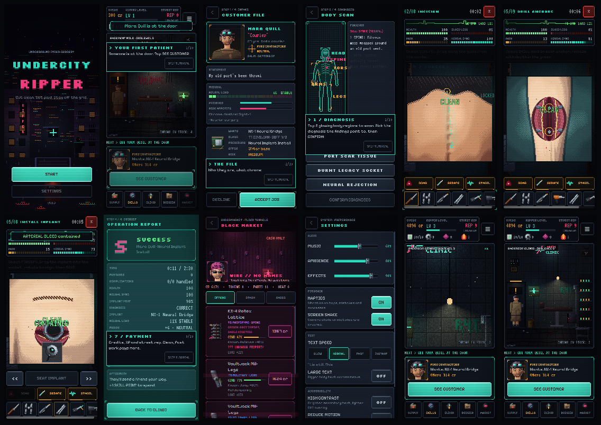

# UNDERCITY: RIPPER

An original 2D pixel-art cyberpunk surgery sim for iPhone. You run an
underground clinic: take customers, diagnose them, install cyberware with
your fingers, handle complications, get paid, and climb toward the black market.

**Status: 1.0.0, a production-ready build.** The game has:
- a guided first shift, then a gradual learning curve
- 8 operations across 8 cyberware categories, with 27 implants (tiers 1–5)
- procedural customers with hidden conditions, and a neural-load system
- 21 upgradeable tools
- 5 factions with heat
- a black market with unknown properties
- a 4-branch skill tree and 6 clinic tiers
- 20 story and random events
- a full settings and accessibility menu
- a layered soundscape and haptics
- detailed, animated pixel art at one consistent density

[CHANGELOG.md](CHANGELOG.md) lists the changes. Design and code are documented in [docs/ARCHITECTURE.md](docs/ARCHITECTURE.md) and [docs/ART_BIBLE.md](docs/ART_BIBLE.md).



---

## Requirements

| | |
|---|---|
| Engine | **Godot 4.3 stable** (standard build, GDScript only, no C#). Newer 4.x versions should open the project and offer to upgrade it. |
| Renderer | GL Compatibility (best fit for 2D on iPhone) |
| Target | iPhone, portrait. Desktop runs for development. |
| iOS export | macOS with Xcode, plus an Apple Developer account for on-device runs |

## Running the game

1. Install Godot 4.3 from <https://godotengine.org/download/archive/4.3-stable/>.
2. Open Godot, choose **Import**, and select `project.godot` in this folder.
3. Press **F5** (Run Project).

From the command line: `godot --path .`

The desktop window opens at iPhone proportions (390×844). **The mouse stands in
for your finger.** On iOS, touches arrive as emulated mouse events, so desktop
and device go through the same input path.

### Playing a shift

A new game starts a **10-step tutorial** on an easy first patient. Coach marks
point at the control to use, and you can skip it at any time. The clinic menu
(≡) has **HOW TO PLAY**, **SETTINGS** and **SAVE & QUIT**. The **NEXT** line
under the clinic view always shows the most useful next step.

1. **Clinic.** A customer shows up at the door, drawn with their own face, outfit and installed chrome. Tap them or **SEE CUSTOMER**. The nav bar opens **SUPPLY**, **SKILLS**, **CLINIC** (upgrades), **DOSSIER** (factions, contacts, rumours, records) and, once you have the contacts, the **MARKET**.
2. **Customer file.** Shows who they are:
   - faction, personality, wealth, patience and risk appetite
   - their current neural load and their medical history
   - what they want and what they'll pay

   **ACCEPT JOB**, or decline (which costs a little rep and faction standing).
3. **Diagnosis.** Scan body regions (at least 2). Scans can reveal **hidden conditions** (rejection-prone, clotting disorder, neural scarring...), which change how the operation behaves. Then pick a diagnosis.
4. **Plan.** Choose which implant unit to install: stock, buy now, a black-market unit, or a salvaged one. Review the checks:
   - required tools (e.g. a drill for limbs)
   - supplies
   - before → after neural load
   - the customer's consent

   Then **BEGIN OPERATION**.
5. **Surgery.** 8–9 stages depending on the procedure. Keep an eye on the vitals and neural sync, and use the emergency buttons.
6. **Results.** You get a grade (S–F), pay, XP, rep, a faction change and heat, plus consequences:
   - referral, a return visit, or becoming a regular
   - a post-op complication
   - a neural break

   Then events may trigger. The game autosaves.

---

## Difficulty and learning curve

Everything keys off the number of completed jobs (`scripts/core/difficulty.gd`):

| Phase | Jobs | What changes |
|---|---|---|
| Tutorial | 0 | Scripted easy patient, ×1.5 tolerances, no complications, guided steps |
| Learning | 1–2 | Forgiving tolerances, at most one slow complication, calm and stable customers (neural load ≤ 45%), no hidden conditions, no random events, jobs match your tools |
| Street | 3–7 | Assist fades to ×1.0. Hidden conditions, second complications and events begin. The black market arrives around job 6 (rep 18) |
| Undercity | 8+ | Full game: risk scales with chrome tier, neural load and conditions. Tier-4 chrome comes at LV8, the late clinic tiers need high rep |

Pacing was checked with `tests/balance_sim.tscn`, which runs the real economy for 40 jobs across several player profiles:
- tier-2 chrome arrives about 8–10 minutes in
- the black market opens at about 15–25 minutes
- tier-3 chrome arrives at about 20–45 minutes
- the third clinic tier comes after about 1 hour

The simulator found no dead ends: there are never more than 3 impossible jobs in a row, money never goes negative, and a struggling player still upgrades the clinic. The checks also close a black-market buy/sell loop.

## Settings and accessibility

The settings are stored in `user://settings.cfg`, separately from the save, so a new game keeps them:
- **Audio:** music, ambience and effects volume (three audio buses)
- **Feedback:** haptics on/off and screen shake on/off. Haptics come in tiers: UI tick, success, warning, mistake, critical and implant, each with its own strength.
- **Text:** text speed (slow / normal / fast / instant typewriter) and large text (+2 pt on every theme text style)
- **Accessibility:**
  - high contrast: brighter secondary text and a lighter CRT overlay
  - reduce motion: no shake, flicker or glitch, and fewer particles
  - colour-independent status everywhere: `!` on warning vitals, `+`/`x` on plan checks, neural bands named in text

## Project structure

```
project.godot            Engine config (portrait, stretch, autoloads, renderer)
export_presets.cfg       iOS export preset (no signing secrets)
data/                    Game content as JSON (cyberware, tools, surgeries, complications, characters,
                         archetypes, names, dialogue, conditions, factions, skills, clinic tiers,
                         events, rumors, black market, palettes, character parts)
systems/                 Autoload singletons (the game's services)
scripts/
  core/                  GameConfig (all tuning values), Palette
  data/                  Typed Resource classes + JSON loader
  surgery/               Vitals, scoring, result, site renderer, lighting, stage registry
    stages/              One script per surgery interaction (9 stage types)
  customers/             Procedural customer generator
  art/                   PixelArt (density helpers), CharacterArt (runtime palette compositing)
  ui/                    UIKit: code-built UI helpers
  screens/               One script per screen (+ BaseScreen, Main root)
  components/            Reusable UI widgets (vital bar, tool tray, scan view, FX...)
  util/                  Safe-area helper
scenes/                  Screen scenes: main, main_menu, clinic, customer, diagnosis, surgery, results,
                         shop, black_market, skills, upgrades, dossier
ui/
  theme/main_theme.tres  Global theme (generated by tools/build_theme.gd)
  components/            Reusable UI scenes (player HUD, dialog)
assets/                  Fonts (OFL), sprites (generated), CRT + black-market glitch shaders
audio/                   Placeholder SFX + ambient loop
tools/                   Reproducible generators: art/ (pixel-art pipeline), audio, theme
tests/                   Unit tests, end-to-end bot, compile check, perf probe
docs/                    ARCHITECTURE.md, ART_BIBLE.md, screenshots (ignored by Godot)
LICENSES/                Font licences (SIL OFL 1.1)
```

## Architecture

### Systems (autoloads, `systems/`)

| Autoload | Responsibility |
|---|---|
| `EventBus` | Cross-cutting signals |
| `GameManager` | Game flow: customer → diagnosis → plan → surgery → results, rewards and consequences |
| `CustomerManager` | Story characters, archetypes, procedural generator, arrival queue, history |
| `SurgeryManager` | Runs an operation: stages, vitals, mistakes, complications, quick actions, result |
| `CyberwareManager` | Implant catalogue, tier access, validity |
| `InventoryManager` | Tools, implant instances (condition, hidden traits), supplies, parts, tokens |
| `EconomyManager` | Money: the only place it changes |
| `ReputationManager` | Street rep and tiers |
| `ProgressionManager` | XP, levels, skill points, records |
| `FactionManager` | 5 faction standings and heat |
| `SkillManager` | Skill tree: Surgery / Cybernetics / Medicine / Underworld |
| `ClinicManager` | Clinic tiers 0–5 |
| `StoryManager` | Story flags, contacts, rumours |
| `EventManager` | Random and story events with choices, timed modifiers |
| `BlackMarketManager` | Stock, unknown traits, buy / sell / study / modify / scrap, cases |
| `ModifierManager` | One stat-modifier stack fed by skills, clinic, tools and events |
| `SaveManager` | Versioned JSON save (v3, with a checksum; migrates v1 and v2) |
| `AudioManager` | Music, ambience profiles and SFX on three buses |
| `UIManager` | Navigation, toasts, dialogs, modals, shake, flash, haptic tiers, `celebrate()` feedback |
| `Settings` | Player preferences (own file) |
| `TutorialManager` | First-shift coach marks |

How the pieces talk to each other:
- Screens call **GameManager** for flow and **UIManager** for presentation. Screens never create other screens.
- Systems emit signals (on `EventBus`, or on `SurgeryManager` for high-frequency surgery events), and the UI listens to them.
- Pure logic (`SurgeryVitals`, `SurgeryScoring`, `NeuralLoad`, `CustomerGenerator`) has no nodes, so it can be unit-tested.
- Every tunable number lives in `scripts/core/game_config.gd` or `data/*.json`. Every bonus (skills, clinic, tools, events) flows through `ModifierManager` keys, listed in [docs/ARCHITECTURE.md](docs/ARCHITECTURE.md).

### Data-driven content

JSON in `data/` loads into typed `Resource` classes. Godot treats `.json` as a
resource, and the iOS preset also has an explicit `data/*.json` include filter,
so exports pick the files up.

Most new content is a data entry (the full table is in [docs/ARCHITECTURE.md](docs/ARCHITECTURE.md#adding-content)):
- **New implant:** an entry in `data/cyberware.json`. The icon is chosen by category and tier.
- **New surgery:** an entry in `data/surgeries.json`. It lists stages by `type` with their own params, so no code is needed.
- **New event, condition, archetype, faction, skill or clinic tier:** the matching JSON file.
- **New interaction type:** subclass `SurgeryStage` and register it in `surgery_stage_registry.gd`.

## How the surgery system works

`SurgeryManager.start_session()` takes:
- a surgery and a customer
- whether the diagnosis was correct
- the implant unit (condition and hidden traits)
- session modifiers (e.g. operating without supplies)

Tolerances scale with:
- the implant's install difficulty
- the customer's neural load and hidden conditions
- tool quality
- skills and clinic modifiers

Each frame it:

- **Ticks the vitals** (`SurgeryVitals`, all values 0–100):
  - **Blood loss** rises at `bleed_rate` while the wound is open. Clotting pulls the rate back toward a baseline.
  - **Health** drains once blood loss passes a safe threshold.
  - **Pain** settles toward a baseline set by the sedation dose.
  - **Neural stability** drains while pain is high and recovers slowly when the patient is calm.
  - **Operation time** counts up and feeds the grade.
- **Checks failure:** health 0 means *flatline*, neural 0 means *neural collapse*.
- **Raises warnings** when a vital crosses its threshold (toast, sound, blinking bar).

Each **stage** is a self-contained interaction drawn over a persistent
`SurgicalSiteView`: the operating room backdrop plus a 160×160 art-pixel
anatomy close-up (neck, forearm, chest, thigh or orbital, recoloured to the
patient's skin). It keeps the incision, clamps, burns, anchors, implant,
wires and stitches across stages. The view renders inside a `SubViewport` at
native art resolution with dithered lamp, monitor and emergency lighting, so
it matches the density of the rest of the game.
Stages never touch systems directly. They emit `mistake`, `effect_requested`,
`feedback` and `stage_finished(quality, data)`, and `SurgeryScreen` routes those
to `SurgeryManager`, the FX layer and audio.

| # | Stage | Touch interaction | Mistakes and consequences |
|---|---|---|---|
| 1 | Prepare patient | **Hold** INFUSE, release in the green band | Underdose: higher pain floor. Overdose: health and neural damage |
| 2 | Incision | Tap **scalpel**, **drag** along the guide | Drifting off the line: bleeding, pain |
| 3 | Expose interface | Tap **retractor**, **tap** the 4 clamp points | Jabbing tissue: tear, bleeding |
| 4 | Remove damaged tissue | Tap **cautery**, **hold** on dark tissue | Touching nerves: neural damage (cautery also seals vessels) |
| 4b | Drill anchors (limbs, spine) | Tap **drill**, **hold** on each anchor, release in the green depth band | Too shallow: loose anchor. Too deep: bone crack |
| 5 | Install implant | Tap **forceps**, **drag** implant into the socket, **rotate** (drag around or `<<`/`>>`), SEAT | Misaligned seat: neural damage, lower implant performance |
| 6 | Connect neural interface | Tap **splicer**, **drag** wires pin → matching terminal (colour *and* shape) | Bad splice: neural shock, pain |
| 7 | Calibrate | **Slide** to match the waves, tap LOCK ×3 | Poor sync: neural damage, lower implant performance |
| 8 | Close incision | Tap **suture**, **tap** stitch points in numbered order | Wrong order: bleeding, pain |

Using the wrong tool is also a (rate-limited) mistake. Mistakes stack. Enough
of them, especially on a sensitive patient, will crash the operation (the test
suite proves this).

**Complications.** After the tutorial job, every operation gets at least one,
timed randomly within a stage that allows them. During the learning phase
there is at most one, with a longer timer. There is a chance of a second, which rises with
customer risk and with a wrong diagnosis. Each one has a countdown and a
counter-action:

| Complication | Counter |
|---|---|
| Arterial bleed | COAG |
| Neural spike | STABIL |
| Patient waking | SEDATE |
| Neural feedback (neural load 55+) | STABIL |
| Rejection spasm (hidden *rejection-prone* condition) | SEDATE |

The three quick actions can also be used at any time, but each has a cooldown.

**Scoring.** Average stage quality, final health, final neural stability and
implant performance are combined, plus a time bonus or penalty. That score
gives the grade (S/A/B/C/D, F on failure), pay, XP and reputation
(`SurgeryScoring`, tuned in `GameConfig`):
- Pay includes a markup on the implant's price.
- XP scales with difficulty.

**Neural load** (bands 0–50 stable, 50–70 minor, 70–85 instability,
85–95 severe, 95+ critical) affects:
- neural drain and starting stability
- complication odds and which complications can appear
- the calibration window
- customer consent
- the chance of a post-op neural break

Details are in [docs/ARCHITECTURE.md](docs/ARCHITECTURE.md#neural-load).

## Touch controls and mobile UI

- **Portrait only.** The base viewport is 360×640 with `canvas_items` stretch and `expand` aspect, so taller iPhones (19.5:9 gives 360×780) get more room instead of black bars.
- **Safe area.** `Main` reads `DisplayServer.get_display_safe_area()` and insets all screens and overlays, which keeps the notch, Dynamic Island and home indicator clear. To preview on desktop, set `GameConfig.DEBUG_SIMULATED_SAFE_AREA`.
- **Touch targets.** Primary buttons are 48–56 units tall (52–60pt on iPhone), and nothing interactive is smaller than 44 units (about 48pt). Small visual targets (clamp points, pins, stitches) get enlarged hit areas resolved to the nearest target. The automated tests assert that every visible button is on-screen and at least 44 units at both 360×780 and 360×640 (iPhone SE).
- **Layout.** Containers and anchors are used throughout. Screens that can run long scroll their middle section and keep the action buttons pinned.
- **Feedback.**
  - a correct action gets a cyan confirmation pulse; a minor mistake gets an amber warning; a major one gets red with a shake; a critical failure gets a flatline tone, a hard flash and the strongest haptic
  - purchases, unlocks and upgrades share one celebration (`UIManager.celebrate`)
  - haptics use `Input.vibrate_handheld(ms, amplitude)` on device
- **Destructive actions confirm first:** abort (which also freezes the patient while you decide), wiping the save, resetting settings, and skipping the tutorial.
- **Suspension.** Backgrounding the app mid-operation pauses it behind a RESUME card.

## Save system

- **What:**
  - money, XP/level, skill points and ranks, reputation
  - faction standings and heat
  - clinic tier
  - tools, implant instances (condition and traits), supplies, parts and tokens
  - black-market stock
  - story flags, contacts, rumours, pending event and timed modifiers
  - customer queue and history, and the waiting customer
  - records and settings
- **Settings** are stored separately in `user://settings.cfg`.
- **Where:** `user://savegame.json`. On iOS this is inside the app's sandbox, so it survives app restarts and updates.
- **How:** each saveable system implements `get_save_data()`, `load_save_data()` and `reset_state()`. `SaveManager` collects them under a `version` field. It writes a temp file, keeps the previous save as `.bak` and then swaps the temp file in. Integrity and recovery:
- Each file ends with an MD5 line over the JSON text, so tampered or truncated files are rejected.
- A rejected main file falls back to the `.bak`.
- If the app is killed between the write and the swap, the temp file is recovered.
- A failed write shows a toast.

The format is version 3, and `_migrate()` upgrades older saves:
- v1 → v2: stock becomes implant instances, veterans get clinic tier 1, and the waiting customer is kept.
- v2 → v3: settings move out of the save, and veterans skip the tutorial.
- **When:** after every operation, purchase and decline, and when the app is backgrounded or closed (`NOTIFICATION_APPLICATION_PAUSED` / `FOCUS_OUT` / `WM_CLOSE_REQUEST`). An operation in progress is never saved: if the app is killed mid-surgery, you reopen in the clinic, before the operation, with the same customer waiting.

## Audio

`tools/generate_audio.py` synthesises the whole soundscape deterministically
(standard library plus `ffmpeg` for OGG):
- **Music:** three seamless loops (clinic, surgery, black market) that crossfade between screens.
- **Ambience:** four layers (electrical hum, ventilation, CRT buzz, distant city) mixed per screen profile, plus random one-shots: drips, sirens, trains, servos, beeps.
- **SFX hooks:** `click`, `tool`, `cut`, `burn`, `clamp`, `zap`, `stitch`, `implant`, `stage`, `mistake`, `warning`, `success`, `failure`, `customer`, `cash`, `levelup`, `drill`, `glitch`, `event`, `beep`, `servo`, `activate`, `critical`, `confirm`, `back`, `denied`, `unlock`, `purchase`, `heartbeat`, `spark`, `tutorial`.

Every button clicks automatically. Any file can be replaced 1:1 with final audio.
On iOS the audio session uses Godot's default **Ambient** category, so the ring/silent switch mutes the game and it mixes with other apps.

## Art pipeline

All art is generated by a reproducible Python/Pillow pipeline in `tools/art/`
at a single global density (1 art pixel = 2 UI units):
- hue-shifted 8-step ramps
- Bayer dithering limited to shade transitions
- shaded primitives with selective outlines
- banded dithered lighting

Characters are palette-indexed parts, composited and recoloured at runtime
(`CharacterArt`), so every customer looks different and their installed chrome
shows. The rules are in [docs/ART_BIBLE.md](docs/ART_BIBLE.md).

```sh
python3 tools/generate_art.py                 # all groups, ~5 s
python3 tools/generate_audio.py               # sfx | ambience | music
godot --headless --path . --script res://tools/build_theme.gd
```

Any PNG can be replaced 1:1 by hand-made art of the same size.

## Tests

```sh
tests/run_tests.sh            # compile check, balance sim, stability suite, unit + E2E at 360x780 and 360x640
```

- **Compile check:** loads every script and scene.
- **Unit and system tests:**
  - vitals, scoring, progression, economy and inventory
  - **insufficient money**, **insufficient tools**, **invalid cyberware** (wrong category or tier), **excessive neural load** (drain, complications, consent, neural break)
  - customer generation (300 customers validated across archetypes, unique looks, seeded determinism, lossless serialisation, portrait compositing)
  - modifiers and skills, factions and heat, clinic upgrades
  - events (including post-op complications), **black-market purchases**, study, sell and modify
  - death and failure
  - save round-trip, corrupt-save recovery and **v1 → v2 migration**
- **End-to-end bot:** plays the game through real pointer events (taps, drags, holds):
  1. clean neural install
  2. sloppy run
  3. arm install that is blocked without a drill, buys the drill in the shop, then completes the anchor-drill stage
  4. aborted op
  5. reckless run that kills the patient
  6. optic install on a generated customer

  It also covers the Wire story event, black-market buy/study/sell through the UI, a skill upgrade, a clinic upgrade, all dossier tabs and a reload. A layout guard asserts that every button is on-screen, at least 44 units, and that nothing overflows the screen width.
- **Balance simulator** (`tests/balance_sim.tscn`): 40 jobs through the real economy for normal and struggling players. It asserts pacing milestones and that there are no dead ends.
- **Stability suite** (`tests/stability_test.tscn`):
  - a 30-shift soak through the real screens, with save → wipe → load every 5 shifts
  - 3,000 random monkey inputs (taps, drags, long presses), after which the game must still navigate
  - rapid screen-change spam
  - 60 fuzzed save files (byte flips, truncation, garbage)
  - node and orphan leak checks
- **Perf probe:** `xvfb-run -a godot --path . --rendering-driver opengl3 res://tests/perf_probe.tscn` prints load time, frame time, draw calls, nodes and memory per screen.

With rendering, the bot also saves screenshots of each step:
`xvfb-run godot --path . --rendering-driver opengl3 --resolution 360x780 res://tests/test_runner.tscn -- --shots=/abs/path`

## Performance

These numbers come from the perf probe (`tests/perf_probe.tscn`) running on a
**software rasterizer** (llvmpipe, CPU-only) at 360×780. An iPhone GPU renders
far faster, so treat them as upper bounds; on-device profiling is still to do
(see the Xcode Instruments note below).

| Screen | Build ms | Avg frame ms | Draw calls | Nodes | Texture MB |
|---|---|---|---|---|---|
| Main menu | 82–88 | 10.4–10.8 | 48 | 70 | 12.4 |
| Clinic (tier 0 / 5) | 48–99 | 10.1–11.6 | 66–68 | 121–123 | 8.4–12.4 |
| Customer | 30–53 | 9.9–11.1 | 57 | 120 | 12.5 |
| Diagnosis | 41–58 | 9.9–11.0 | 39 | 97 | 12.5 |
| Surgery | 91–176 | 11.3–12.8 | 61 | 106 | 13.8 |
| Shop / Skills / Upgrades / Dossier / Settings | 20–71 | 8.4–10.9 | 17–65 | 84–282 | 8.8–12.4 |
| Black market (full-screen glitch shader) | 89–173 | 14.5–17.0 | 59 | 130 | 11.7 |

Totals:
- Static memory is 35–40 MB and texture memory peaks at about 14 MB.
- The stability soak (30 operations) keeps the node count flat (112 → 112) with no orphan nodes.

Design choices that keep it light:
- Sprites are tiny and cached at 2×.
- The surgical field is one SubViewport at half resolution.
- Wound geometry is precomputed once per incision (29 ms → 6.6 ms after optimisation).
- Character composites are cached (up to 48).
- Particles are capped (12 emitters, halved with Reduce Motion).
- Ambient animation draws a few pixels from precomputed anchors.
- Audio is OGG streamed (about 1.7 MB in total).
- There are no per-frame allocations in the vitals loop.

**On device:** profile with Xcode → Product → Profile → *Time Profiler* / *Game
Performance* on the oldest iPhone you support. Godot's debugger monitors also
work over remote debug.

## Building for iPhone

### 1. Required Godot version
**Godot 4.3 stable**, standard build (not .NET), from
<https://godotengine.org/download/archive/4.3-stable/>. The project uses the
GL Compatibility renderer. 4.4+ will offer to upgrade the project; the iOS icon
options changed in 4.4, so stay on 4.3 for the preset in this repo.

### 2. macOS and Xcode setup
- A Mac running a macOS version supported by your Xcode.
- A current **Xcode** (15 or newer) from the Mac App Store. Open it once to accept the licence and install the iOS platform components.
- Command line tools: `xcode-select --install`.
- An Apple ID. A free account can run builds on your own iPhone for 7 days; the **Apple Developer Program** is needed for TestFlight and the App Store.

### 3. iOS export templates
In Godot: **Editor → Manage Export Templates → Download and Install** (4.3.stable).
Offline, use **Install From File** with `Godot_v4.3-stable_export_templates.tpz`.

### 4. Apple signing configuration
1. Open **Project → Export → iOS**. The preset ships in `export_presets.cfg`; its icons, launch image, portrait orientation, version 1.0.0 (build 3) and arm64 are already set.
2. Set **Application → App Store Team ID**. It's the 10-character Team ID from developer.apple.com → Membership, or from Xcode → Settings → Accounts.
3. Replace the placeholder **Bundle Identifier** `com.example.undercityripper` with your own reverse-DNS ID (e.g. `com.yourstudio.undercityripper`). It must match an App ID in your developer account (Xcode can create it automatically).
4. Choose how to sign:
   - **Automatic signing (recommended):** leave the provisioning profile UUIDs empty, export the Xcode project, and let Xcode manage signing (step 6).
   - **Manual signing:** fill in the provisioning profile UUIDs and signing identities in the preset.
5. Keep your signing values out of git. Godot stores them in `.godot/export_credentials.cfg`, and `.godot/` is ignored.

### 5. Build for a physical iPhone
1. **Project → Export → iOS → Export Project…**
2. Choose `build/ios/` (git-ignored) and name it `UndercityRipper`.
3. Tick **Export Project Only** to get the Xcode project without running `xcodebuild`. Godot writes `UndercityRipper.xcodeproj` plus the game `.pck`.
4. Scripted equivalent (macOS): `godot --headless --path . --export-debug "iOS" build/ios/UndercityRipper.ipa` (use `--export-release` for release). With *Export Project Only* enabled, it stops after writing the Xcode project into `build/ios/`.

### 6. Run through Xcode
1. Connect the iPhone by USB (or pair it over Wi-Fi in Xcode) and trust the Mac.
2. On the iPhone, enable **Settings → Privacy & Security → Developer Mode** (iOS 16+) and restart.
3. Open `build/ios/UndercityRipper.xcodeproj`.
4. Select the **UndercityRipper** target → **Signing & Capabilities**. Tick *Automatically manage signing* and pick your team.
5. Pick your iPhone as the run destination and press **Run (⌘R)**.
6. With a free Apple ID, the first launch asks you to trust the developer under **Settings → General → VPN & Device Management**.

Checks on device:
- portrait lock
- safe areas (notch, Dynamic Island, home indicator)
- haptics (Settings → Haptics)
- the silent switch muting audio
- the save surviving an app kill (swipe it away and relaunch)

### 7. Create an App Store build
1. In Xcode, set the run destination to **Any iOS Device (arm64)**.
2. **Product → Archive**. When it finishes, the Organizer opens.
3. **Distribute App → App Store Connect → Upload**. This needs a paid Developer Program membership and an app record in App Store Connect with the same bundle ID.
4. In App Store Connect, add the build to **TestFlight** for testing, then fill in the store listing, privacy details, screenshots and age rating before submitting for review.
5. For each new build, bump `application/version` (the build number) in the iOS preset; bump `short_version` for user-facing releases.

The preset also handles three icon details:
- The app icon is pixel art on a 60 px grid, so the 120/180 px icons are exact 2×/3× scales.
- `icon_interpolation` is nearest-neighbour.
- Every icon slot points at a pre-scaled PNG in `assets/ios/`.

> No App Store submission has been made from this repository. The steps above are the procedure; signing and submission happen on your own Apple account.

## Credits and licences

- Fonts: VT323, Silkscreen and Pixelify Sans, each under the SIL Open Font License 1.1 (see `LICENSES/`).
- All other art, audio and code are original to this project.
- *UNDERCITY: RIPPER* is an original IP and is not affiliated with any existing cyberpunk franchise.
