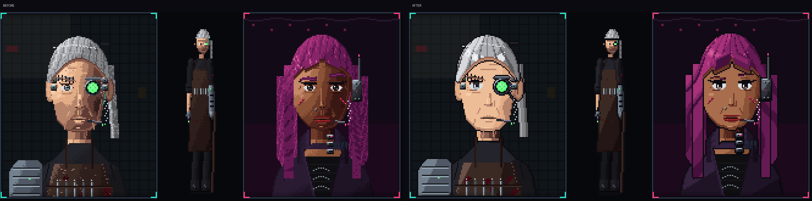
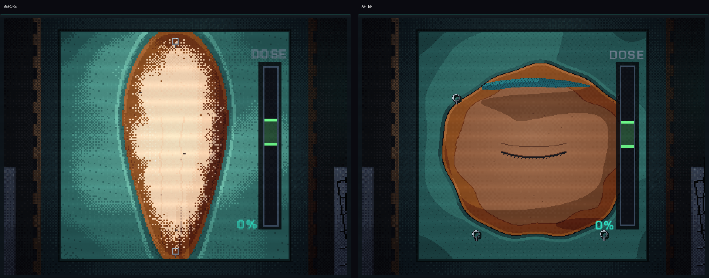
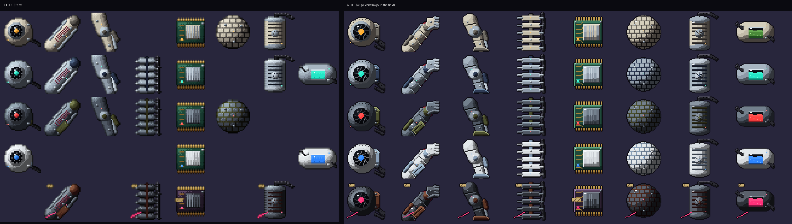

# Graphics overhaul: characters, surgery and implants

The character, operating-field and implant art moves to clean, modern
character pixel art: flat cel bands, no dithering, a near-black ink
contour on every form, hard speculars and catch-lights, and more pixels
where the old art was coarse.

## What changed

**Characters** (`tools/art/hdc_*.py`, `characters_hd.py`). Same parts,
layout and recolouring at runtime; new rendering:
- every silhouette part (head, hair, clothes, cyberware, accessories,
  in-room bodies) is closed by a 1 px ink contour (`hdc_core.ink_outline`);
- shading lands on four flat bands (`HDCanvas.shade_px`), no Bayer dither;
- faces are lit flat with one shadow band on the far side and under the
  cheekbone, cheek and chin lights, a cast hair shadow on the forehead;
- eyes: a two-row ink lash line winging past the outer corner, a tall
  iris dark under the lid and light below, a 2 px pupil, a white
  catch-light; brows are crisp and tapered; noses and lips are light and
  shadow shapes; age is a few clean strokes;
- hair falls in clumps split by dark strand lines, with a glossy band
  round the crown, pointed fringe locks, and flat (not stippled) shaved
  and buzzed areas.

**Implants** (`tools/art/cyberware_art.py`). One design per category and
tier, rasterised at 48 px (item icon, shown at `ART_SCALE` so it keeps the
old 96-unit footprint) and 64 px (`cyberware/field/`, the operating
field). New detail: segmented plates over synthetic muscle and an
articulated fist on the arm, aperture blades and a mounting bracket on
the optic, knee joint and foot on the leg, heat-sink fins and gold pins
on the neural chip, a hex weave on the dermal mesh.

**Operating field** (`tools/art/regions.py`,
`scripts/surgery/surgical_site_view.gd`, `scenes/surgery/surgery_screen.tscn`).
The five anatomy close-ups are 320 px (were 160). The field still works on
its 160 px grid; its controls sit under a `FieldRoot` scaled by
`SurgicalSiteView.ART_RES` (2), so the viewport draws two art pixels per
field pixel. The anatomy and the implant (on the tray, in the hand,
placed and seated) are drawn at that resolution; the implant's footprint,
socket, key slot, hit tests, wound and skin masks are unchanged. The zoom
steps 2x / 4x / 6x (the same 4x default at 1080p).

## Checks

- Full `tests/run_tests.sh`: ALL SUITES PASSED, including the implant
  placement tests, the rendered implant probe for every category at
  1920x1080 and 1280x720, the procedure test that every surgical point lies
  on skin, and the layout probes at four resolutions and three window
  modes.

## Not changed

Clinic rooms, streets, city map, tool icons, UI frames, the surgery
backdrops behind the field and the diagnosis body scan. The in-room body
sprites keep their 60x120 size (restyled with the contour and cel bands)
so they stay at the clinic room's pixel density.

All art is still generated by this repository's procedural scripts; no
image was traced, upscaled or taken from elsewhere.
